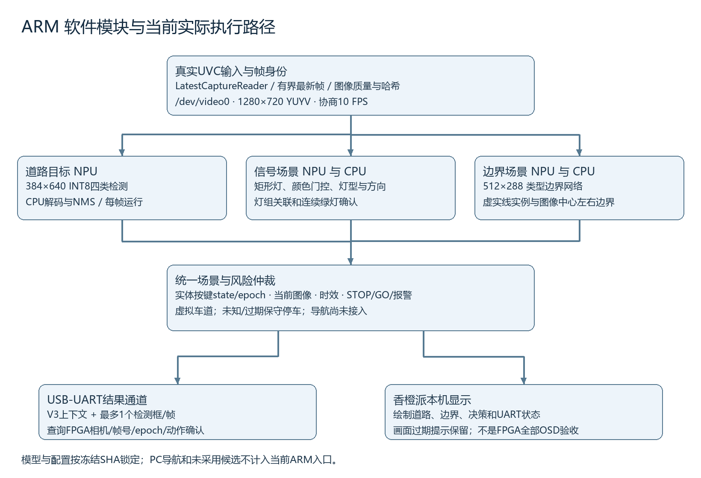
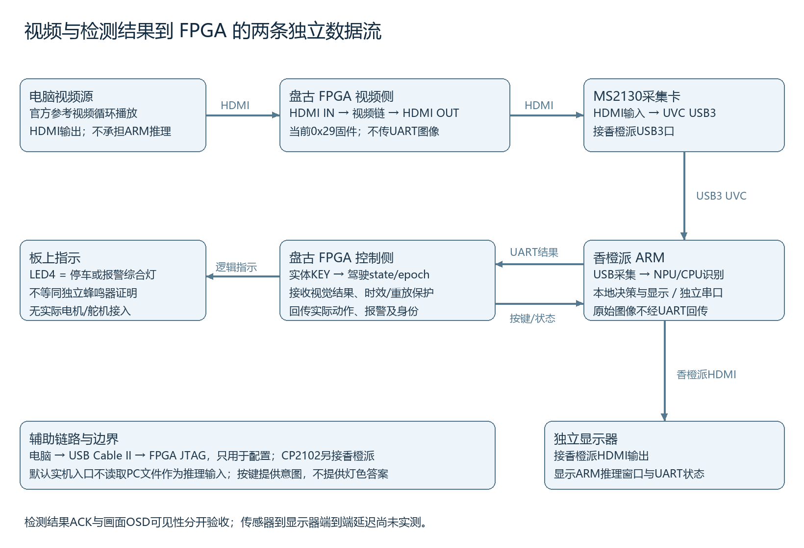

# 基于Orange Pi 3B的道路视觉识别与FPGA协同系统ARM技术说明

整理日期为2026年11月2日。本材料供队友合并紫光同创赛题三技术报告。实现说明以已演示的ARM冻结源码为依据，实验成绩均对应已有记录，不把后续候选、PC测试或人工观测扩展成整机验收结论。

## 一 目标与已实现范围

我们在Orange Pi 3B的RK3566处理器上完成道路视频取帧、目标识别、信号灯与边界场景判定、结果显示和USB-UART通信。FPGA提供视频链路、实体按键、结果接收与保护判定及板上指示。当前已留存的实体功能用例包括停车、直行绿行、红停、强行红灯报警与停车清警。

当前车道由按键选择为虚拟左转、直行或右转意图，图像模块再判断候选灯组、灯色/灯型和道路风险。本系统没有完成纯图像真实本车道几何定位与灯头物理归属验证，也没有接入实际车辆的电机或舵机。导航仅有PC阶段材料，未接入当前ARM统一入口。

## 二 硬件及系统结构

ARM平台为Orange Pi 3B RK3566，现场板载内存约8GiB；FPGA器件为PGL50H-6IFBG484。MS2130作为HDMI到USB3的视频采集设备，CP2102用于115200波特率串口。显示器接香橙派HDMI输出，电脑承担官方视频播放及FPGA下载，不承担本轮ARM图像推理。

视频由电脑HDMI送入FPGA，再由FPGA HDMI输出进入MS2130，MS2130通过UVC向香橙派提供图像。ARM检测结果通过另一条USB-UART链路回到FPGA。两条路径独立：视频不经过串口，完整检测画面也不通过UART回传。当前识别窗口来自香橙派本机绘制，不能把它说成已经在FPGA端实现全部OSD叠加。

## 三 ARM软件模块与实现

### 3.1 当前实际版本

入口为 `run_unified_demo.py`，板上固定目录为 `/home/orangepi/adas2026/signal_recovered_20261028`。完整源码、15个模型和配置位于本包 `01_ARM实机程序/runtime`。冻结清单SHA256为 `09c4795d9457f6aff117643234edb6c7fcdd12395a5d7268ec11c32aba0005dd`；实际固件为0x29，反馈build_tag=41。运行参数为720p、YUYV、10 FPS，灯模型capture_ft、道路模型int8、分类器batch2、full布局、灯壳细化及几何提议。

`light_metadata.json`保留了原阶段来源；实际capture_ft参数会覆盖灯模型文件名，使用 `lamp_aligned_fp_heads.rknn`。不能仅按历史metadata或导出时的adopted=false字段推断运行权重；本包以运行源码、实测参数和文件哈希共同锁定版本。未用10月29日新候选覆盖原稳定模型。

### 3.2 采集与图像身份

`LatestCaptureReader`独立子进程持续读取 `/dev/video0`，使用有界共享缓冲保留最新图像。最终推理取全幅1280×720输入，预检中的tiles模式仅用于重新协商和确认输入，不是最终两路摄像头。输入异常、无新帧或显著均匀画面不能建立通行许可。

每帧携带相机ID、主机帧号、图像哈希和解码完成时间。解码完成时间属于用户态时钟，不是相机曝光时间或FPGA像素采样时间；尚未证明FPGA视频帧与ARM帧号一一对应。程序保留这项限制，不通过重设旧帧时间戳规避过期检查。

### 3.3 道路目标与场景识别

道路四分类模型输入为384×640，类别为交通灯、车辆、两轮车和行人。FP32训练权重经ONNX裸输出头导出和INT8 RKNN转换，在NPU运行；CPU负责解码和NMS。道路目标给风险模块提供当前图像中的候选框，不单凭“有行人”即宣称碰撞或所有场景已验收。

信号场景采用矩形灯检测、颜色发光检查、灯型/方向判断、几何灯组提议及连续性规则。当前有效绿灯需连续确认，未知灯、关联不明或时效不足采取保守停车。检测到红/绿颜色只是中间结果，不等于完成真实车道—灯头归属。

边界场景使用512×288的类型边界分割模型，类别为背景、实线边界和虚线边界。它预测的是连续的类型边界走廊，不能用掩码是否连续判断虚实；后处理再提取实例、图像中心左右边界和可用线段。当前版本对变道功能的实板完整回归仍待补齐。

### 3.4 按键与仲裁

实体KEY2选择场景，KEY3/4/5选择左/直/右，KEY6切换行驶请求与停车，KEY7提出强行请求。按键返回state和epoch，ARM在推理前后核对状态；发生按键变化时等待新图像重新判定，旧结果不能冒用新驾驶请求。

仲裁由当前图像结果、驾驶意图、图像质量、时效和风险状态共同决定。停车请求可限制运动，红灯强行请求保持STOP并报警。日志中的simulation_only、virtual_lane及hardware_motion_control_connected=False表示虚拟驾驶场景和无真实车辆执行机构；真实运行位置应以source_mode=live_capture、采集进程和板端模型记录判断。

### 3.5 通信与显示

串口逐包发送、校验ACK并查询带相机/帧号/epoch的FPGA状态，避免只凭三字节ACK认定当前动作已确认。图像时效在发送边界再次编码，FPGA按剩余租约判断过期/重放并停车。界面显示ARM动作、布尔报警、驾驶请求及UART确认状态；旧画面超过500 ms会覆盖过期提示。

实测显示提示仍可能出现；本次不提高阈值或刷新时间戳掩盖该问题。LED4为停车或报警综合灯，ALARM布尔值与FPGA alarm_code枚举分别说明。

## 四 实验设计与结果

### 4.1 实体闭环功能

以0x29固件及本包ARM哈希固定版本进行控制场景测试。每个用例从实体按键转换后连续取90帧，保留首帧切换、过期及未确认失败，不挑选成功段。每帧需同时满足有效输入、时效、按键一致、图像决策、对应相机/帧号/epoch的FPGA确认及预期动作/报警。团队阶段门槛为成功比例至少70%且错误放行记录为0，不是官方统一通过线。

| 实体功能用例 | 成功帧/总帧 | 比例 | 错误放行记录 |
| --- | --- | --- | --- |
| 实体KEY6绿行 | 65/90 | 72.22% | 0 |
| 实体KEY6停车 | 90/90 | 100.00% | 0 |
| 实体KEY6红停 | 89/90 | 98.89% | 0 |
| 实体KEY7强行红灯报警 | 88/90 | 97.78% | 0 |
| 实体KEY6停车清除报警 | 89/90 | 98.89% | 0 |
| 辅助冷恢复后实体KEY6绿行 | 66/90 | 73.33% | 0 |

这些是受控片段的闭环检查比例，不是神经网络精确率或实路安全保证。相邻帧有强相关性，没有据此计算独立道路成功概率。实体按键和人工屏幕答复另有记录，不把远程测试驾驶报文当作实体按键证明。

### 4.2 最新HDMI实时恢复短测

2026年11月1日重新识别MS2130，用电脑跳动计时标记核实输入确在更新，再通过原停车预检恢复实时运行。约24.98秒处理76帧，流水线吞吐为3.04帧/秒；状态发送确认76/76，输入质量有效76/76，采集重连为0。该段场景为boundary，不作为所有模型/场景的统一帧率。

从解码完成到结果准备的图像年龄：均值373.0 ms、中位数370.9 ms、P95 471.1 ms，范围311.0–495.8 ms。这不是曝光/HDMI源到实际显示的端到端延迟。采集协商为10 FPS，也不等于模型推理10 FPS。

该次会话最后已处理1160帧后进入stopped，错误列表为空；用户接受现场采集效果。没有把正常停止误报为崩溃，也没有声明已证明停止触发方式。截图保留了displayed image expired提示，因此不能宣称显示时效已全部验收。

### 4.3 离线识别指标

对应当前灯模型源权重的PC评估，在已知开发验证画面上以conf=0.25、NMS IoU=0.7、匹配IoU=0.5统计：200个真值、164个预测，TP=148、FP=16、FN=52，P=90.24%、R=74.00%、F1=81.32%。绿灯正确检出75/96；这是检测诊断，不是ARM闭环绿行比例。相关退化视图P=88.41%、R=72.50%，增强视图不增加独立道路来源。

道路四分类源模型在1000张BDD开发验证图上的历史PC报告：P=42.88%、R=33.28%、mAP50=32.65%、mAP50–95=15.74%。不能略去较弱类别或把转换输出一致率当真值准确率；当前INT8部署模型未另做完整人工真值精度复测。

RKNN道路INT8与原输出对照的42个样例，匹配输出325/参考340，匹配输出325/候选335，说明转换一致性；没有独立人工真值，不能写成“准确率97%”。导航4/4卡片结果仅为PC极小相关验证集，未算入ARM或整机成绩。

## 五 资源与工程限制

采集1280×720 YUYV10的名义像素负载为147.456 Mb/s，不包含USB开销，也不是实测总线吞吐。串口为115200、8N1，无硬件流控，传送结构化检测/状态而非图像。单个上下文20字节、单个框20字节，当前入口限制每帧最多1个框；坐标归一到1920×1080协议画布。

已用独立采集进程、有界最新帧缓冲、单NPU所有者、单后处理任务和日志轮换控制资源。11月1日主进程快照RSS约234 MiB，但不包括所有子进程、驱动或NPU保留内存，不是总内存峰值；板端可用存储约577MiB，低于512MiB会保护停止。

人工辅助冷恢复已完成，仍需电脑恢复SRAM和视频源。FPGA0x29完整setup/hold/removal时序仍有违例，传感器到屏幕端到端延迟未实测。上述未完成项必须由最终合并报告保留，不能用受控功能成绩抵消。

## 六 来源与复现

道路与类型边界使用BDD100K相关数据；灯色使用S²TLD及赛题官方参考视频裁剪，包含AI辅助复核标注。YOLO架构及预训练初始化来自Ultralytics；RKNN转换/运行来自Rockchip SDK；OpenCV、NumPy和ONNX Runtime等提供处理与推理支撑。训练权重、运行模型、导出哈希、许可证和来源链接已另附。

团队已确认本项目未使用往年师兄工程。开发板IP、模型框架、数据集和预训练权重等第三方来源保留各自说明与许可。

从开机到运行见根目录README；统计可在无YOLO、无板卡条件下运行 `06_测试结果与统计/recompute_metrics.py` 重算。完整模型、配置、图像证据和真实串口收发日志随包交付。比赛模板拿到后由队友将本说明分别放入总体方案、软件实现、接口、测试和参考来源章节。
